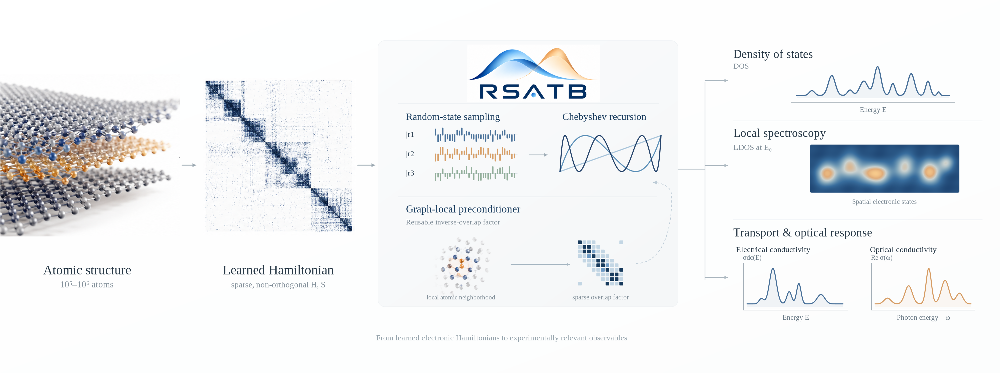
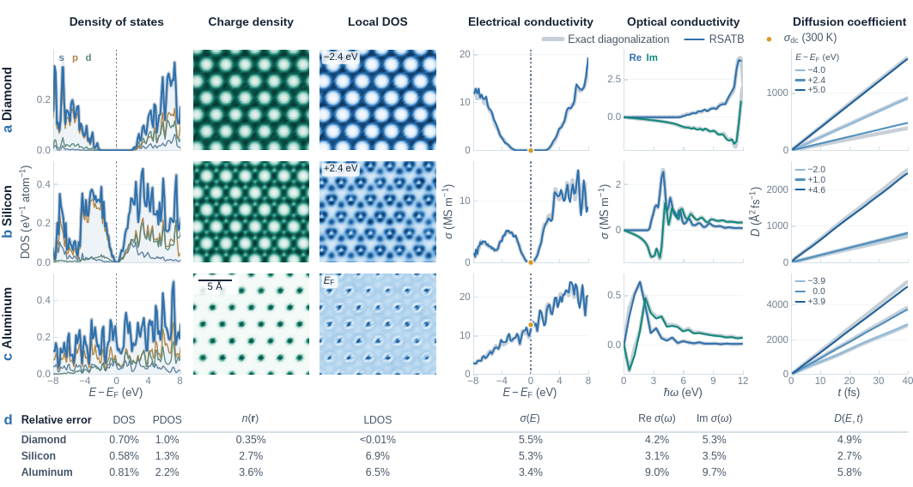
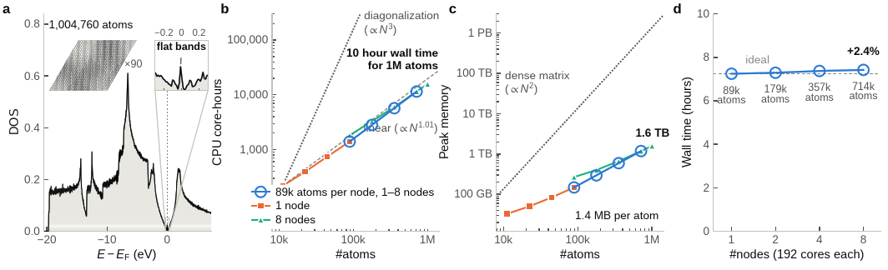
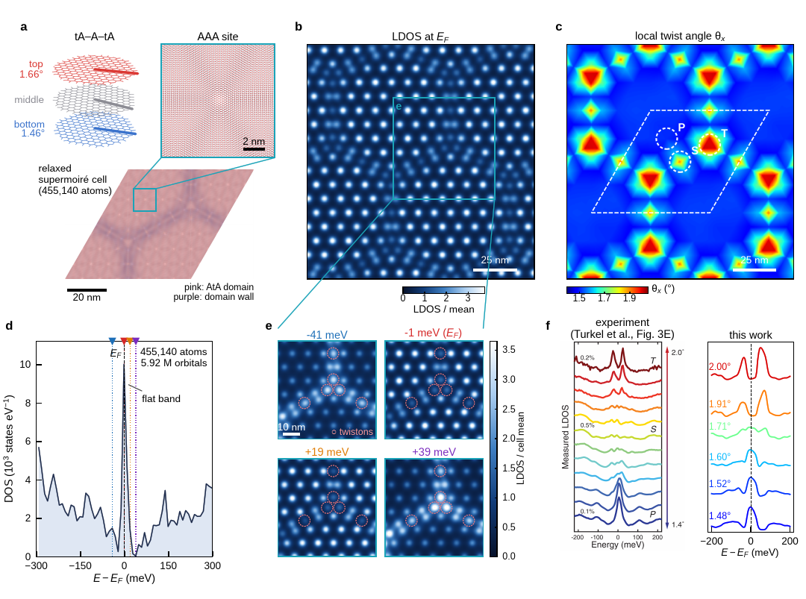

<h1 align="center">RSATB</h1>

<p align="center">
  <strong>Electronic observables at million-atom scale. Random-State Ab-initio Tight Binding for sparse, non-orthogonal Hamiltonians.</strong>
</p>

<p align="center">
  <a href="#installation"></a>
  
  
  <a href="LICENSE"></a>
</p>

<p align="center">
  
</p>

RSATB is a distributed real-space solver for localized-orbital Hamiltonians. It fills a growing gap: linear-scaling DFT and machine-learning electronic-structure methods can now produce very large Hamiltonians, yet practical tools for extracting physical observables remain limited. RSATB combines random-state estimators, Chebyshev recurrences, two-center and grid integrals, and a graph-local inverse-overlap factor to compute those observables directly, even when the atomic basis is non-orthogonal.

## Why RSATB?

- **No dense diagonalization.** Sparse matrix operations replace a global eigensolve, making systems with hundreds of thousands to millions of atoms accessible.
- **Non-orthogonal by construction.** LCAO and DFTB overlap matrices are handled through a reusable graph-local `S^-1/2` preconditioner.
- **Built for clusters.** Distributing atomic computation, high-performance optimized algorithms.

## Results at a glance

### Validated across materials and observables

<p align="center">
  <a href="doc/fig/fig_validation.pdf">
    
  </a>
</p>

RSATB tracks exact-diagonalization references for diamond, silicon, and aluminum across the DOS, charge density, LDOS, electrical and optical conductivity, and diffusion coefficient.

### Near-linear scaling to one million atoms

<p align="center">
  <a href="doc/fig/fig_scaling.pdf">
    
  </a>
</p>

The benchmark reaches **1,004,760 atoms** with near-linear CPU and memory growth and near-constant wall time under weak scaling across nodes.

### A 5.92-million-orbital supermoiré application

<p align="center">
  <a href="doc/fig/fig_application.pdf">
    
  </a>
</p>

The application above resolves spectra and spatial electronic structure in a **455,140-atom, 5.92-million-orbital** twisted-trilayer graphene supermoiré.

## Installation

### Recommended: a fresh conda environment

Clone the repository with its pinned source dependencies, create an isolated environment, and build the Python package plus native solver:

```bash
git clone --recurse-submodules https://github.com/floatingCatty/rsatb.git
cd rsatb

conda create -n rsatb -c conda-forge \
  python=3.11 compilers cmake ninja openmpi mpi4py \
  blas lapack fftw hdf5 libmatio metis parmetis primme
conda activate rsatb

python -m pip install .
rsatb info
```

`rsatb info` should report the four model families, the available tasks, a loadable solver, and the MPI rank count. If you already cloned without submodules, run `git submodule update --init --recursive`. CMake can also fetch the same pinned sources when the submodule directories are absent, so source archives remain buildable.

<details>
<summary><strong>System dependencies and a non-conda build</strong></summary>

You need Python 3.9 or newer, CMake 3.15 or newer, a C++17 compiler, MPI, BLAS/LAPACK, FFTW, HDF5 with its C++ library, MATIO, METIS, ParMETIS, and PRIMME. Once they are visible to CMake:

```bash
python -m pip install .
```

CMake accepts `-DBLAS_BACKEND=Auto|MKL|OpenBLAS|Generic` and dependency roots such as `-DHDF5_ROOT=...`, `-DFFTW_ROOT=...`, `-DMETIS_ROOT=...`, `-DPARMETIS_ROOT=...`, `-DPRIMME_ROOT=...`, and `-DMATIO_ROOT=...`.

</details>

<details>
<summary><strong>Digital Research Alliance of Canada clusters</strong></summary>

Activate the virtual environment in which RSATB should be installed, then run:

```bash
bash scripts/install_alliance.sh
```

The script loads the Alliance module stack, verifies native headers and shared libraries, installs the Python dependencies, builds RSATB, and checks the resulting extension. Use `RSATB_MODULES` to replace the default module list or `RSATB_EXTRA_MODULES` to append site-specific modules.

</details>

> [!NOTE]
> RSATB is research software under active development. For production science,
> record the version and input, check stochastic convergence with `nsamples`,
> and check spectral/time resolution for the observable being reported.

## Quick start

The fastest path is a self-contained graphene calculation—no structure or parameter files are required:

```bash
rsatb template sktb -o graphene.json  # write a runnable input
rsatb check graphene.json             # validate without loading the solver
rsatb run graphene.json               # run on one MPI rank
```

The input is unchanged for a parallel calculation:

```bash
mpirun -n 64 rsatb run graphene.json
```

An RSATB input has a simple shape:

```text
structure  -> where the atoms are
model      -> how H(R), S(R), and the basis are constructed
run        -> sampling, k-points, bounds, and preconditioning
tasks      -> the observables to compute, in order
output     -> where results are written
```

<details>
<summary><strong>Minimal self-contained input</strong></summary>

```json
{
  "structure": {
    "positions": [[0.0, 0.0, 10.0], [0.0, 1.42, 10.0]],
    "symbols": ["C", "C"],
    "cell": [[2.4595, 0.0, 0.0], [1.22975, 2.13, 0.0], [0.0, 0.0, 20.0]],
    "pbc": [true, true, false]
  },
  "model": {
    "type": "sktb",
    "basis": {"C": ["pz"]},
    "hamiltonian": {
      "onsite": {"C": {"pz": 0.0}},
      "pairs": {
        "C-C": {
          "pp_pi": {"kind": "constant", "value": -2.7, "r_cut": 1.6}
        }
      }
    }
  },
  "run": {
    "nsamples": 64,
    "kpoints": [[0.0, 0.0, 0.0]]
  },
  "tasks": [
    {"type": "energy_bounds"},
    {"type": "dos", "dE": 0.1}
  ],
  "output": {"dir": "results/graphene"}
}
```

</details>

### Choose a Hamiltonian source

| `model.type` | Use it for |
|---|---|
| `sktb` | Slater-Koster onsite and hopping functions supplied directly in the input |
| `dftb` | A directory of DFTB `.skf` parameter files |
| `lcao` | A precomputed H(R) plus numerical atomic orbitals; non-orthogonal overlap is constructed from the basis |
| `tb_file` | A precomputed orthogonal H(R) file |

### Choose one or more observables

| Goal | Task types |
|---|---|
| Spectrum and populations | `energy_bounds`, `dos`, `pdos`, `occupation`, `fermi_level` |
| Real-space electronic structure | `density`, `ldos` |
| Electrical and optical response | `dc`, `dc_spectrum`, `ac` |
| Dynamics and quantum geometry | `msd`, `quantum_metric` |

Tasks run in order against one setup. A DOS and an AC calculation in the same input, for example, reuse the same Hamiltonian, overlap treatment, and domain decomposition.

### Discover the interface from the command line

```bash
rsatb template --list          # runnable starting points
rsatb doc tasks                # available observables
rsatb doc tasks.ac             # every AC option and default
rsatb show graphene.json       # resolved input with defaults filled in
rsatb schema > rsatb.schema.json
```

The schema is the single source of truth for `rsatb check`, `rsatb show`, `rsatb doc`, and the runtime. Validation does not require MPI or the compiled solver, so inputs can be checked before they reach a compute queue.

## Examples and API

- [`examples/`](examples/) contains runnable inputs for graphene SKTB, LCAO diamond, DFTB parameters, precomputed tight-binding files, and transport.
- [`doc/json_input.md`](doc/json_input.md) is the complete JSON reference.
- [`doc/python_api.md`](doc/python_api.md) documents the Python layer for generated structures, parameter sweeps, and custom post-processing.
- [`doc/`](doc/) contains algorithm and implementation notes for the solver.

The command-line input and Python API meet at the same objects:

```python
from mpi4py import MPI  # initialize MPI before constructing native objects
from rsatb.inputs import build_calculation, load_and_resolve

resolved, issues = load_and_resolve("graphene.json")
if any(issue.is_error for issue in issues):
    raise ValueError(issues)

calculation, model, options = build_calculation(resolved)
dos, energy = calculation.compute_dos(dE=0.1)
```

## Citation

Until the accompanying paper is released, please cite the software metadata in [`CITATION.cff`](CITATION.cff). The paper citation will be added there after publication.

RSATB is developed by [Zhanghao Zhouyin](https://floatingcatty.github.io/), Department of Physics, McGill University.
[ORCID](https://orcid.org/0000-0002-0954-1650) · [Google Scholar](https://scholar.google.com/citations?user=vSMmfvUAAAAJ)

## License

RSATB is available under the [Apache License 2.0](LICENSE).
