<p class="rs-kicker">Getting started</p>

# Anatomy of an input

<div class="rs-lead" markdown>
Every RSATB input answers five questions, one per section. Learn them once
and every example, template and tutorial reads the same way.
</div>

```json
{
  "structure": { },   // where the atoms are
  "model":     { },   // what the Hamiltonian is
  "run":       { },   // how the calculation is carried out
  "tasks":     [ ],   // which observables to compute
  "output":    { }    // where results go
}
```

`structure` and `model` are required; `run`, `tasks` and `output` have
defaults. The sections line up one-for-one with the Python objects the
library is built from — `Structure`, a model, `SetupOptions` and the
`compute_*` methods — so a JSON key maps onto a constructor argument, never
onto a private translation layer.

## The sections

<div class="grid cards" markdown>

-   **[`structure`](../reference/input/structure.md)** — where the atoms are

    ---

    A file (POSCAR, CIF, XYZ) or inline positions, symbols and cell, plus an
    optional `supercell` tiling. Coordinates are used exactly as written:
    nothing is wrapped, sorted or renumbered, because a Hamiltonian file's
    atom indexing refers to that order.

-   **[`model`](../reference/input/model/index.md)** — what the Hamiltonian is

    ---

    One of four families, selected by `type`: Slater-Koster parameters
    (`sktb`), DFTB tables (`dftb`), a DFT Hamiltonian with its orbitals
    (`lcao`) or an orthogonal H(R) file (`tb_file`).

-   **[`run`](../reference/input/run.md)** — how it is carried out

    ---

    k-points, the number of random vectors (`nsamples`), the spectral window
    (`bounds`), the overlap treatment (`preconditioner`) and k-point
    parallelism (`npar`).

-   **[`tasks`](../reference/input/tasks/index.md)** — what to compute

    ---

    A list of observables, run in order against one setup. Each is selected
    by `type` and configured by its own keys.

</div>

[`output`](../reference/input/output.md) sets the directory, a file-name
prefix and the archive format.

## What happens in a run

```mermaid
flowchart LR
  A[input.json] --> B{rsatb check}
  B -- errors --> X[refuse to start]
  B -- valid --> C
  subgraph C[setup — once]
    direction TB
    C1[atomic graph<br/>from cutoffs] --> C2[H&#40;k&#41;, S&#40;k&#41;<br/>per k-point]
    C2 --> C3[S^-1/2 factor<br/>non-orthogonal only]
    C3 --> C4[spectral window<br/>PRIMME or fixed]
  end
  C --> D[task 1] --> E[task 2] --> F[…]
  D -.-> O[(dos.npz)]
  E -.-> P[(ac.npz)]
  F -.-> S[(summary.json)]
```



**Setup runs once.** The atomic graph is built from the model's cutoffs and
distributed across ranks; the Hamiltonian (and overlap) are assembled at each
k-point; a non-orthogonal model gets its $S^{-1/2}$ factor; and the spectral
window that every Chebyshev expansion is scaled to is estimated. **Tasks then
run in order** against that setup, each writing its archive as soon as it
finishes. Asking for a DOS and an optical spectrum in one input therefore costs
one setup, not two.

At the end, a profile table reports where the wall time and peak memory went:

```text
  phase                                 wall(s)  peak(GB)       %    calls
  setup/spectral_bounds                    0.74      0.14   45.8%        1
  setup/isqrt_ns_ZH_S_Z                    0.24      0.14   14.9%       11
  setup/overlap_sample_k                   0.16      0.14    9.9%       11
  ...
```

## What a model can compute

Which observables are available follows from the operators a model supplies.
`rsatb check` reports a mismatch before anything runs.

| `model.type` | overlap | velocity | position |
|---|:---:|:---:|:---:|
| `sktb` without `overlap` | — | ✓ | ✓ |
| `sktb` with `overlap` | ✓ | — | — |
| `lcao` | ✓ | ✓ | ✓ |
| `dftb` | ✓ | — | — |
| `tb_file` | — | ✓ | ✓ |

Conductivities (`dc`, `dc_spectrum`, `ac`), the quantum metric and the
mean-square displacement need **velocity**. The real-space maps (`ldos`,
`density`) need the radial orbital files, so an `lcao` model, at a single
Gamma point.

## Rules every input follows

**Unknown keys are errors.** Enums are closed and every issue names its exact
path. A typo fails loudly instead of silently becoming a default.

**Comments are keys that start with `_`.** `"_comment"`, `"_why_this_mesh"`
and the like are carried through uninterpreted, at any depth, so an input can
explain itself.

**Paths are relative to the input file.** An input and its data can move
together; the working directory does not matter.

**Nothing is declared that can be derived.** Orbital counts and graph cutoffs
come from the model's parameters or basis files. Only `tb_file` must be told
its basis, because its file formats carry no basis header.

**Units are fixed.** Energies in eV, lengths in Å, temperatures in K, times in
fs. k-points are fractional coordinates of the reciprocal lattice.

**Verbosity is not part of the input.** How loud a run is describes the
invocation, not the calculation, so it is the `--log-level` flag
(`silent`, `summary`, `progress`, `debug`) and never an input key.

## The commands

| Command | Needs the solver | What it does |
|---|:---:|---|
| `rsatb doc [topic]` | no | explain the format, in full or one topic |
| `rsatb template NAME -o FILE` | no | write a working input to start from |
| `rsatb check FILE` | no | validate schema, files and consistency |
| `rsatb show FILE` | no | print the input with every default filled in |
| `rsatb schema` | no | export the schema as JSON Schema |
| `rsatb run FILE` | yes | set up and compute |
| `rsatb info` | — | what this build supports |

Full flags are on the [Command line](../reference/cli.md) page.
