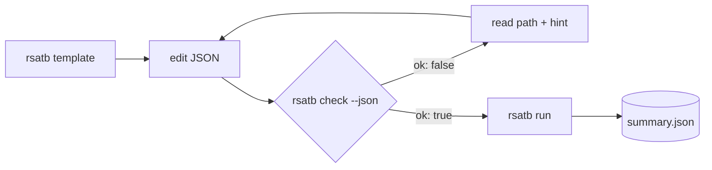

<p class="rs-kicker">How-to guide</p>

# Drive RSATB from an agent

<div class="rs-lead" markdown>
RSATB was designed so that a program — a workflow engine, a script, or an AI
coding agent — can write an input, find out exactly what is wrong with it, and
read the results, without scraping prose. This page lists that surface.
</div>

## What to read

| Resource | What it is |
|---|---|
| <a href="../../llms.txt"><code>/llms.txt</code></a> | An index of this site in the [llms.txt](https://llmstxt.org) format |
| <a href="../../llms-full.txt"><code>/llms-full.txt</code></a> | The whole documentation as one Markdown file |
| [`/rsatb.schema.json`](../rsatb.schema.json) | The input schema as JSON Schema 2020-12 — identical to `rsatb schema` |
| `rsatb doc <topic>` | The reference for one section, task or model, as plain text, offline |
| `rsatb template <name>` | A known-good input to start from |

Every input key on this site is generated from the same declaration the
validator uses, so the documentation, `rsatb doc`, the JSON Schema and
`rsatb check` cannot disagree.

## The loop



### 1 · Start from a template

```bash
rsatb template --list
rsatb template lcao -o input.json
```

### 2 · Validate, machine-readably

`rsatb check --json` prints a report on stdout and exits **0** when the input
is valid, **1** when it is not:

```console
$ rsatb check --json input.json
{
  "input": "input.json",
  "ok": false,
  "issues": [
    {
      "severity": "error",
      "path": "run.kpoint",
      "message": "unknown key 'kpoint'",
      "hint": "did you mean 'kpoints'?"
    }
  ]
}
```

Each issue carries a `path` into the document (`tasks[1].energies`,
`model.hamiltonian.path`), a `severity` (`error` or `warning`), a message and,
where one exists, a `hint` with the fix. Warnings do not block a run. Checks
cover three layers: the schema (types, ranges, unknown keys), the file system
(every path resolved against the input's directory), and physics consistency
between sections:

```text
error: tasks[0]: 'ac' needs the velocity operator, which the 'sktb' model with these inputs does not supply
error: tasks[1]: 'ldos' currently requires a single Gamma point, but run.kpoints has 4
```

`--no-files` skips the file checks, for inputs written on one machine and run
on another.

### 3 · See what will actually run

```bash
rsatb show input.json          # the input with every default filled in
rsatb run input.json --dry-run # validate and report what would run, then stop
```

### 4 · Run, then read the record

```bash
rsatb run input.json --log-level silent
```

`summary.json` in `output.dir` is the machine-readable record: the resolved
input, the derived basis, the spectral window, every scalar result, and the
shape, dtype and file of every array. See [Output files](../reference/outputs.md).

## Rules worth encoding

- Unknown keys are errors. Do not add keys speculatively; consult the schema.
- Keys beginning with `_` are comments and are always accepted.
- Relative paths are resolved against the **input file's** directory.
- Units are fixed: eV, Å, K, fs; k-points are fractional.
- Verbosity is a CLI flag (`--log-level`), never an input key.
- `msd` needs the Gamma point among `run.kpoints`. `ldos` and `density` need
  `run.kpoints` to be the Gamma point alone, an `lcao` model, and every
  periodic cell width above twice the orbital cutoff (the last is checked at
  run time, not by `rsatb check`).
- Prefer one input with several tasks over several inputs: tasks share one
  setup.

## From Python

The same layer is importable, with no compiled code involved until a run:

```python
from rsatb.inputs import load_and_resolve

resolved, issues = load_and_resolve("input.json")
errors = [i.as_dict() for i in issues if i.is_error]   # same dicts as --json
```

`rsatb.inputs.resolve(document, base_dir=None, check_paths=False)` validates a
dict you built in memory.
