<p class="rs-kicker">Guide</p>

# Choose a model

<div class="rs-lead" markdown>
The model type follows from the data you have. It also determines which
tasks are available, because some tasks need operators (velocity, position,
real-space orbitals) that not every model type provides.
</div>

## Start from your data

```mermaid
flowchart TD
  Q{What do you have?}
  Q -->|Slater-Koster parameters you can write down| SK[sktb]
  Q -->|a directory of DFTB .skf files| DF[dftb]
  Q -->|H&#40;R&#41; from a DFT or ML code + .orb files| LC[lcao]
  Q -->|an H&#40;R&#41; file already in an orthogonal basis| TB[tb_file]
```



| You have | `model.type` | Overlap | Basis comes from |
|---|---|---|---|
| Onsite energies and two-centre hoppings you write | [`sktb`](../reference/input/model/sktb.md) | only if you give `overlap` | `basis` you declare |
| DFTB parameters (mio, 3ob, …) | [`dftb`](../reference/input/model/dftb.md) | always | `basis` you declare |
| A DFT/ML Hamiltonian (DeePTB, ABACUS, NextHam) plus its numerical orbitals | [`lcao`](../reference/input/model/lcao.md) | always, computed from the `.orb` files | the `.orb` files |
| An orthogonal H(R) file, e.g. a DeePTB Slater-Koster export | [`tb_file`](../reference/input/model/tb_file.md) | never | `type_norb`, `cutoff_radius` you declare |

## What each can compute

| | DOS, PDOS, occupation | DC / AC / quantum metric | MSD | LDOS, density |
|---|:---:|:---:|:---:|:---:|
| `sktb`, orthogonal | ✓ | ✓ | ✓ | — |
| `sktb` with `overlap` | ✓ | — | — | — |
| `dftb` | ✓ | — | — | — |
| `lcao` | ✓ | ✓ | ✓ | ✓ |
| `tb_file` | ✓ | ✓ | ✓ | — |

The reasons are:

- **Velocity** is the commutator $i[H, r]$. Orthogonal models get the position
  operator from the atomic coordinates; `lcao` computes the dipole integrals
  from its orbitals. A non-orthogonal `sktb` or `dftb` model has neither, so
  transport tasks are not available.
- **Real-space maps** evaluate orbitals on a grid, so they need radial
  functions, which only `.orb` files provide.
- **MSD and the real-space maps** are computed at the $\Gamma$ point only;
  use a supercell instead of a k-mesh.

`rsatb check` reports these cases before a run starts:

```text
error: tasks[0]: 'ac' requires the velocity operator, which this sktb model does not provide
error: tasks[1]: 'ldos' requires an lcao model, whose orbital files give the orbitals in real space
error: tasks[1]: 'ldos' requires a single k-point at Gamma, but run.kpoints has 4
```

## Orthogonal and non-orthogonal models

For an orthogonal model each Chebyshev step is one sparse product with $H$.
A non-orthogonal model also applies $S^{-1/2}$ (or a solve with $S$) at each
step, and its spectral window is usually wider, so each step costs more. See
[Non-orthogonal bases](../theory/overlap.md).

## Spin

`spin` on any model is one of `none`, `collinear`, `noncollinear` or
`spinorbit`. `noncollinear` and `spinorbit` double the basis. For an `lcao`
model read from an nspin = 4 ABACUS or NextHam file, use `spinorbit`: see
[Import DFT Hamiltonians](hamiltonian-files.md#spin-orbit).
