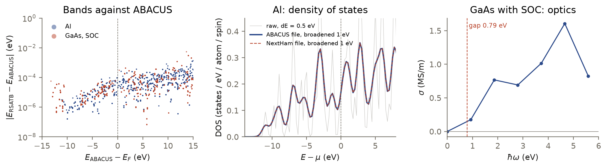

<p class="rs-kicker">Tutorial 7 · Going further</p>

# ABACUS and NextHam

<div class="rs-lead" markdown>
This tutorial uses Hamiltonians written by ABACUS or predicted by
NextHam. It first checks that a file was read correctly, then computes a
metal (fcc Al) and a semiconductor with spin-orbit coupling (GaAs).
</div>

<div class="rs-chips">
  <span class="rs-chip rs-chip--advanced">Advanced</span>
  <span class="rs-chip">Model: lcao</span>
  <span class="rs-chip">ABACUS · NextHam</span>
</div>

<div class="rs-learn" markdown>
**You will learn** to read an ABACUS or NextHam $H(\mathbf R)$, to check it
against ABACUS's band energies, and to run spin-orbit calculations.
</div>

The inputs and data are in `examples/abacus_nextham/`:

```bash
cd examples/abacus_nextham
```

## The model

ABACUS and NextHam Hamiltonians are LCAO Hamiltonians, so both are read by an
`lcao` model with the `.orb` files of the ABACUS calculation. Only
`hamiltonian.format` differs:

=== "ABACUS"

    ```json
    "model": {
      "type": "lcao",
      "hamiltonian": {
        "path": "data/al/abacus/data-HR-sparse_SPIN0.csr",
        "format": "abacus"
      },
      "orbitals": {
        "names": ["Al_gga_8au_100Ry_4s4p1d.orb"],
        "dir": "data/al"
      },
      "spin": "none"
    }
    ```

    ABACUS writes this file with `out_mat_hs2 1` in its `INPUT`
    (`data-HR-sparse_SPIN0.csr` in ABACUS 3.10, `hrs1_nao.csr` in newer
    versions).

=== "NextHam"

    ```json
    "model": {
      "type": "lcao",
      "hamiltonian": {
        "path": "data/al/nextham/HR_atom_pairs.h5",
        "format": "nextham"
      },
      "orbitals": {
        "names": ["Al_gga_8au_100Ry_4s4p1d.orb"],
        "dir": "data/al"
      },
      "spin": "none"
    }
    ```

    NextHam's post-processing writes `HR_atom_pairs.h5`. The file in this
    example holds the ABACUS Hamiltonian above, written in NextHam's format,
    so the two runs can be compared.

Two rules apply to both formats:

- **Atom order.** The structure must list the atoms in the order of the
  ABACUS calculation (its `STRU` file).
- **Orbital files.** Use the `.orb` files of the ABACUS calculation, one per
  element, in order of increasing atomic number.

## 1 · Check the import

Before computing anything, compare the bands of the imported Hamiltonian
with those ABACUS printed, at ABACUS's own k-points:

```console
$ python check_bands.py al abacus
al / abacus: 868 k-points x 16 bands; max |e_rsatb - e_ABACUS| = 1.0e-01 eV (below E_F 9.6e-05 eV)
$ python check_bands.py gaas_soc nextham
gaas_soc / nextham: 216 k-points x 38 bands; max |e_rsatb - e_ABACUS| = 5.4e-03 eV (below E_F 6.1e-05 eV)
```

The occupied bands agree to $10^{-4}$ eV. A wrong atom order, orbital file or
spin setting gives errors of electronvolts.

## 2 · A metal: aluminium

<!-- rsatb-input: examples/abacus_nextham/al_abacus.json -->

New in this input:

- **A supercell and a k-mesh together.** The primitive cell is tiled
  3 × 3 × 3 (27 atoms) and sampled on a 2 × 2 × 2 mesh, which together sample
  the primitive Brillouin zone on a 6 × 6 × 6 grid. `npar` = 8 gives each
  k-point its own group of processes.
- **`fermi_level`** finds the chemical potential that holds `n_electrons`.
  Al carries 11 valence electrons per atom, so the cell holds
  $27 \times 11 = 297$.
- **`dc`** computes the DC conductivity at `mu` = 11.55 eV, the Fermi level
  of this k-point sampling.

```bash
OMP_NUM_THREADS=4 mpirun -n 8 rsatb run al_abacus.json
```

```text
  k-points      8 (2x2x2 mesh)
  parallel      npar=8, nsamples=16
  tasks         dos, fermi_level, dc
  ...
  fermi_level: n_electrons=297, ..., mu=11.635, ...
```

- **Fermi level.** 11.64 eV, against 11.55 eV from exact diagonalization of
  the same k-point sampling. ABACUS reports 11.02 eV, from its own
  12 × 12 × 12 mesh: a metal's Fermi level depends on the sampling, so `dc`
  uses the value for the sampling it runs on.
- **Conductivity.** 1.84, 1.94 and 2.02 MS/m for $xx$, $yy$ and $zz$,
  averaged over the k-points. Cubic Al gives equal components; the spread is
  the noise of this small run. The magnitude is not the conductivity of real
  aluminium: a perfect crystal does not scatter electrons, so the value is set
  by the energy resolution (500 moments over a 415 eV window, about 1.3 eV).
  See [Tutorial 4](transport.md).

**From a NextHam file,** the input differs only in `hamiltonian`:

```bash
OMP_NUM_THREADS=4 mpirun -n 8 rsatb run al_nextham.json
```

The NextHam file holds the same Hamiltonian, and the results agree: the
density of states to within $2 \times 10^{-9}$, the Fermi level and the
conductivity to eight digits.

## 3 · Spin-orbit coupling: GaAs

<!-- rsatb-input: examples/abacus_nextham/gaas_soc_nextham.json -->

New in this input:

- **`"spin": "spinorbit"`** reads a Hamiltonian from a spin-orbit
  calculation (ABACUS `nspin 4`). Every orbital carries both spin
  components, so the 16-atom cell has 496 basis functions, and $H$ is complex.
- **The orbital files** are listed in order of increasing atomic number: Ga
  (31) before As (33).
- **`occupation`** counts the electrons below `mu`, here placed in the
  middle of the band gap. The cell holds $8 \times (13 + 5) = 144$.
- **`ac`** computes the optical conductivity with the same `mu`.

```bash
OMP_NUM_THREADS=4 mpirun -n 8 rsatb run gaas_soc_nextham.json
```

```text
  occupation: n_electrons=144.444, ..., mu=7.795, ...
```

The electron count is 144.4, against 144. The optical conductivity is zero
below the 0.79 eV band gap of this Hamiltonian and rises above it.

<figure markdown>

<figcaption><strong>Left:</strong> the difference between the bands of the
imported Hamiltonian and ABACUS's own, at ABACUS's k-points: below
$10^{-4}$ eV for the occupied bands. <strong>Centre:</strong> the density of
states of Al at a resolution of 1 eV from the ABACUS file (blue) and the
NextHam file (dashed); the two curves coincide. The peaks are the discrete
levels of the 27-atom cell on a 2 × 2 × 2 mesh; a larger cell or k-mesh
smooths them.
<strong>Right:</strong> the optical conductivity of GaAs with spin-orbit
coupling, on this input's frequency grid (0.93 eV steps).</figcaption>
</figure>

## Summary

- ABACUS and NextHam Hamiltonians are read by an `lcao` model, with the
  `.orb` files of the ABACUS calculation; only `hamiltonian.format` differs.
- Compare the bands with ABACUS before a production run.
- A spin-degenerate basis holds one spin, a spinor basis both: electron
  counts are halved for `"spin": "none"` and not for `"spinorbit"`.
- With spin-orbit coupling, densities of states, conductivities and optical
  spectra are available; the real-space maps (`ldos`, `density`) are not.

??? deep "Tutorial-sized settings"
    These inputs use small cells, few random vectors and coarse resolution so
    that they run in minutes. For production results increase `supercell`,
    the k-mesh, `nsamples` and the resolution (`dE`, `n_moments`, `nt`), and
    check convergence as described in
    [Converge a calculation](../guides/convergence.md).

??? deep "Producing a NextHam file"
    NextHam predicts $H(\mathbf R)$ from an ABACUS input Hamiltonian with its
    `pre_post_process` scripts: `pre_process.py` reads the ABACUS run,
    `infer.py` runs the trained model, and `post_process.py --convert-only`
    writes `HR_atom_pairs.h5`. Point `hamiltonian.path` at that file; the
    `SR_atom_pairs.h5` written next to it is not needed, because RSATB
    computes the overlap from the orbital files, unless `model.overlap` names a file.

    Without a trained model, `examples/abacus_nextham/to_nextham.py` writes
    an ABACUS Hamiltonian in NextHam's format, as was done for this example.

??? deep "Large systems"
    NextHam files and ABACUS's binary output are read in parallel: each
    process reads only the rows of its own atoms. ABACUS's text output is
    read by a single process. Above about $10^4$ atoms, convert a text file
    once with `to_nextham.py`.

## Next steps

- Point `hamiltonian.path` at your own ABACUS output or NextHam prediction;
  keep the structure in the ABACUS atom order.
- [Tutorial 8](python.md) runs RSATB from a Python script.
