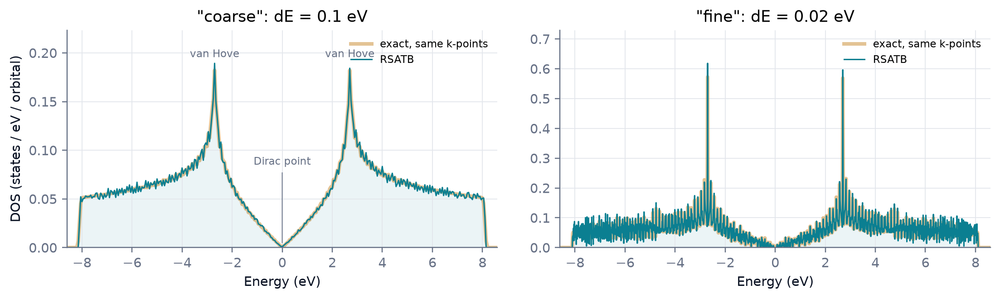

<p class="rs-kicker">Tutorial 1 · The basics</p>

# Graphene density of states

<div class="rs-lead" markdown>
A nearest-neighbour $p_z$ model of graphene, first in the two-atom cell and
then in a 128 × 128 supercell, compared with the exact density of states.
</div>

<div class="rs-chips">
  <span class="rs-chip rs-chip--beginner">Beginner</span>
  <span class="rs-chip">≈ 2 min</span>
  <span class="rs-chip">Model: sktb</span>
</div>

<div class="rs-learn" markdown>
**You will learn** how a model is written, how to make a large system from a
small cell, and how to set the energy resolution of a density of states.
</div>

## Step 1 — a two-atom cell

Graphene has two carbon atoms per cell, each with one $p_z$ orbital, joined to
three neighbours by a hopping of $-2.7$ eV. The input:

<!-- rsatb-input: examples/01_sktb_graphene.json -->

Four sections, read top to bottom:

| Section | Here it says |
|---|---|
| `structure` | two carbon atoms in a hexagonal cell, periodic in-plane |
| `model` | one $p_z$ orbital per carbon, hopping $-2.7$ eV to neighbours within 1.6 Å |
| `run` | use 64 random vectors at the $\Gamma$ point |
| `tasks` | report the energy range, then compute the density of states |

Run it:

```bash
rsatb run examples/01_sktb_graphene.json
```

```text
  bounds        [-8.600000, 8.600000] eV
```

The two eigenvalues of the two-atom cell at $\Gamma$ are
$\pm 3 \times 2.7 = \pm 8.1$ eV; the reported range adds 0.5 eV of padding on
each side.

## Step 2 — a real system

A two-atom cell at one k-point has only two levels. To sample the
Brillouin zone, the cell is repeated 128 × 128 times (32,768 atoms) with
`supercell`:

```json
"supercell": [128, 128, 1]
```

The density of states is computed at two resolutions in the same run:

```json
"tasks": [
  {"type": "dos", "label": "coarse", "dE": 0.1},
  {"type": "dos", "label": "fine",   "dE": 0.02}
]
```

??? example "The complete input — `examples/tutorials/graphene_dos.json`"
    <!-- rsatb-input: examples/tutorials/graphene_dos.json -->

```bash
rsatb run examples/tutorials/graphene_dos.json
```

<figure markdown>

<figcaption><strong>RSATB (blue) and the exact result for the same k-points
(vermilion).</strong>
Left, at 0.1 eV: the familiar graphene density of states, with a V-shaped
Dirac point at zero and sharp van Hove peaks at ±2.7 eV. Right, at 0.02 eV:
the resolution is now finer than the gaps between the energy levels of this
finite cell, so individual levels show through.</figcaption>
</figure>

## What to take away

- `supercell` repeats the structure; the model is unchanged.
- `dE` sets the energy resolution. A finer resolution costs more and is only
  meaningful if the level spacing of the cell is smaller.
- The statistical error decreases with the number of orbitals, so eight
  random vectors were sufficient here (details below).

??? deep "Under the hood: the number of random vectors"
    RSATB never diagonalizes the Hamiltonian. It estimates the density of
    states from random vectors, and the statistical error falls as
    $1/\sqrt{n_{\text{samples}} \times N_{\text{orbitals}}}$. With 32,768 orbitals,
    eight vectors give noise below the line width in the figure; small cells
    need many more. The details are in
    [Random-state traces](../theory/stochastic-trace.md).

??? deep "Under the hood: normalizing the result"
    The `dos` array is scaled so that it integrates to the width of the
    energy range, $E_{\max} - E_{\min}$. Divide by that width to get states per eV
    per orbital:

    ```python
    import json
    import numpy as np

    run = "examples/tutorials/results/graphene_dos"
    summary = json.load(open(f"{run}/summary.json"))
    emin, emax = summary["setup"]["energy_bounds"]

    d = np.load(f"{run}/coarse.npz")
    energy, rho = d["energy"], d["dos"][0] / (emax - emin)
    ```

## Try next

- Set `nsamples` to 1 and compare the noise on the fine curve.
- Continue to [Tutorial 2](lcao-diamond.md): the same workflow with a
  Hamiltonian from a DFT code.
