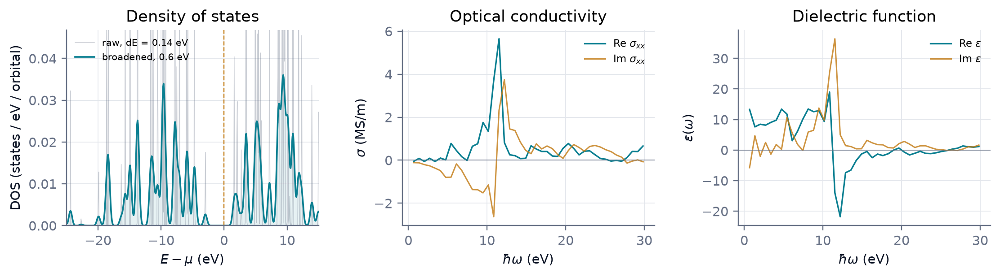

<p class="rs-kicker">Tutorial 3</p>

# Optical response

<div class="rs-lead" markdown>
The optical conductivity $\sigma(\omega)$ is the current–current correlation
function of the crystal, and from it follow the dielectric function, the
refractive index and the absorption coefficient. This tutorial computes all
of them for a 128-atom diamond cell, together with its density of states,
from one non-orthogonal LCAO setup.
</div>

**You will learn:** the `ac` task · supercells instead of k-meshes · choosing
$\mu$ in a gap · reading complex tensor output.

## The input

<!-- rsatb-input: examples/tutorials/diamond_optics.json -->

- **The primitive cell is tiled $4\times4\times4$** at load. A supercell at
  Gamma folds the corresponding k-mesh of the primitive cell onto one point,
  so a single k-point samples the Brillouin zone — the usual way to run
  large-cell RSATB.
- **The overlap is handled in the sandwich form,** with $S$ released after
  setup. Both tasks reuse the same $S^{-1/2}$.
- **`dos`** asks for 0.14 eV resolution across a window that, as in
  [Tutorial 2](lcao-diamond.md), spans about 270 eV.
- **`ac`** samples the current correlator at `nt` = 200 times, with the Fermi
  operator expanded in `n_kpm` = 500 moments at 300 K. The chemical potential
  $\mu = 16.23$ eV sits inside the gap of this cell, which runs from about
  13.3 to 17.8 eV.
- **`nsamples` = 16** random vectors. Too few shows up as noise and as
  negative excursions of derived quantities such as the absorption
  coefficient.

!!! info "Tutorial-sized"
    This input is a reduced version of
    `examples/07_lcao_diamond_dos_ac.json`, which uses 128 samples, 400 time
    steps and 1,000 moments — 15–30 times the cost. Every Chebyshev step here
    pays for a 13-orbital basis and a 270 eV window, so LCAO optics is far more
    expensive per atom than the graphene tutorials. Use example 07, or the
    1,024-atom example 08, for converged spectra.

## Run it

```bash
rsatb run examples/tutorials/diamond_optics.json
```

```text
  basis         C · 13 orbitals · cutoff 3.704 Å
  bounds        [-8.617703, 263.988666] eV
  [1/2] dos
        ✓ 25.1s
  [2/2] ac
        ✓ 1m 15s
done in 1m 50s
```

## The result

<figure markdown>

<figcaption><strong>Left:</strong> the DOS around the chemical potential
(dashed). The 128-atom cell at Gamma has a discrete spectrum, so the raw
0.14 eV result is a comb of levels (grey); a 0.6 eV Gaussian broadening shows
the band picture, with the gap between about −2.9 and +1.6 eV.
<strong>Centre:</strong> the optical conductivity $\sigma_{xx}(\omega)$.
<strong>Right:</strong> the dielectric function derived from it.</figcaption>
</figure>

**The physics is there.** Absorption sets in near 5.4 eV, around the direct
gap at $\Gamma$ that a GGA Hamiltonian gives, and $\operatorname{Re}\sigma_{xx}$
peaks at 11.5 eV, close to diamond's main interband absorption peak near
12 eV. Below the onset the conductivity is zero within noise, as it must be in
the gap.

**The symmetry check passes.** For a cubic crystal the three diagonal
components are equal and the off-diagonal ones vanish. At the peak,
$\sigma_{xx}$, $\sigma_{yy}$ and $\sigma_{zz}$ agree within 6%, and
$\sigma_{xy}$ is 0.6% of them — a direct measure of the sampling noise of 16
random vectors.

**The resolution is coarse, and you can see why.** The `ac` task samples the
correlator at the Nyquist step of the spectral window, so `nt` time steps
cover $0$ to $\omega_{\max} \approx 136$ eV, here in steps of 0.68 eV. The
window is that wide because of the basis, not the physics. Doubling `nt`
halves the step — that is what example 07 does — and the cost of the `ac`
task grows with it.

!!! warning "Noise in derived quantities"
    With 16 samples the absorption coefficient dips below zero by up to 18% of
    its maximum, and the low-frequency $\varepsilon_1$ — obtained by a
    Kramers–Kronig transform of a noisy, truncated spectrum — is not
    quantitative. Raise `nsamples` (example 07 uses 128) before reading
    numbers off these curves.

## Reading the result

The `ac` archive holds complex tensors with six components on the last axis,
in the order (xx, xy, xz, yy, yz, zz):

```python
import numpy as np

ac = np.load("examples/tutorials/results/diamond_optics/ac.npz")
XX = 0
omega_ev = ac["omega_cm1"] / 8065.56          # frequency axis, eV
sigma = ac["sigma"][0, :, XX]                  # complex, S/m
eps = ac["epsilon"][0, :, XX]                  # complex dielectric function
n = ac["refractive_index"][0, :, XX]
alpha = ac["absorption_coefficient"][0, :, XX] # 1/cm
```

For a cubic crystal $\sigma_{xx} = \sigma_{yy} = \sigma_{zz}$ and the
off-diagonal components vanish — a free check on the sampling noise.

## Try next

- `examples/07_lcao_diamond_dos_ac.json` is the converged version of this
  input; `examples/08_lcao_diamond888_dos_ac.json` runs it on an
  $8\times8\times8$ cell (1,024 atoms), where the DOS becomes a band spectrum
  rather than a comb and fewer samples are needed because the trace
  self-averages. Both are sized for a compute node.
- Add `{"type": "quantum_metric", "nt": 400, "n_kpm": 1000, "mu": 16.2253}`:
  the quantum metric is an integral over the same absorption.
