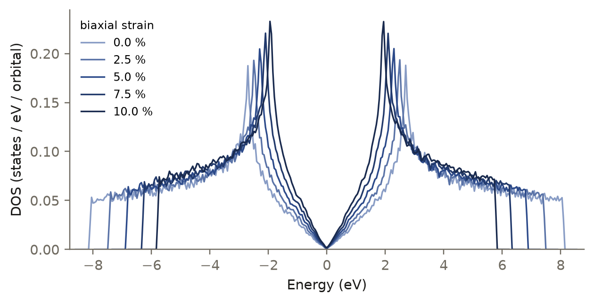

<p class="rs-kicker">Tutorial 7 · Going further</p>

# Python scripting

<div class="rs-lead" markdown>
A parameter sweep with the Python API: the density of states of graphene
under biaxial strain from 0 to 10%.
</div>

<div class="rs-chips">
  <span class="rs-chip rs-chip--advanced">Advanced</span>
  <span class="rs-chip">≈ 2 min</span>
  <span class="rs-chip">Python API</span>
</div>

<div class="rs-learn" markdown>
**You will learn** to build a structure and a model in Python, run a
calculation in a loop, and run the script in parallel.
</div>

## The idea

Stretching graphene pulls the atoms apart, which weakens the hopping between
them, so the band gets narrower. The script repeats one calculation at five
strains, from 0% to 10%, each on 32,768 atoms.

## The script

```python title="examples/tutorials/strain_sweep.py"
--8<-- "examples/tutorials/strain_sweep.py:21:84"
```

It has three parts, mirroring the sections of an input file:

| Function | Builds | Input-file equivalent |
|---|---|---|
| `graphene(strain)` | a stretched `Structure` | `structure` |
| `model()` | an `SktbModel` with a distance-dependent hopping | `model` |
| `main()` | `SetupOptions`, then an `RSATB` per strain | `run`, `tasks` |

## Run it

```bash
python examples/tutorials/strain_sweep.py                # one process
mpirun -n 4 python examples/tutorials/strain_sweep.py    # four processes
```

```text
strain  0.0%   |t| = 2.700 eV   window [-8.60, 8.60] eV
strain  2.5%   |t| = 2.482 eV   window [-7.94, 7.94] eV
strain  5.0%   |t| = 2.281 eV   window [-7.34, 7.34] eV
strain  7.5%   |t| = 2.097 eV   window [-6.79, 6.79] eV
strain 10.0%   |t| = 1.928 eV   window [-6.28, 6.28] eV
```

<figure markdown>

<figcaption>Stretching narrows the band: the band edges and the van Hove
peaks move inwards with the weakening hopping, while the Dirac point stays
at zero. Each curve is a 32,768-atom calculation.</figcaption>
</figure>

## What to take away

- Each section of an input file corresponds to a Python object:
  `Structure`, a model class, `SetupOptions`, and `RSATB` with its
  `compute_*` methods.
- `mpi4py` must be imported before any RSATB object is created.
- Python is suited to loops and generated structures; input files to single
  runs that are archived with their results.

??? deep "Under the hood: the hopping model"
    The hopping decays exponentially with bond length,

    $$
    t(r) = t_0\,e^{-\beta\,(r/a_0 - 1)}, \qquad t_0 = -2.7\ \text{eV},\ a_0 = 1.42\ \text{Å},\ \beta = 3.37 .
    $$

    That is RSATB's `exp_poly` radial form $P(r)\,e^{-\lambda r}$, with a
    one-term polynomial $P = t_0 e^{\beta}$ and $\lambda = \beta/a_0$. The
    `r_on`/`r_cut` taper brings it smoothly to zero before second neighbours.
    Each energy window is $3|t| + 0.5$ eV, exactly as the output shows.

??? deep "Under the hood: API details worth knowing"
    - `Structure.from_arrays` takes **flat** positions (three numbers per atom)
      and a **row-major** 3 × 3 cell.
    - `SkParameters` keys a pair by a tuple, `("C", "C")`, where an input file
      writes `"C-C"`. Omitting `overlap` makes the model orthogonal.
    - `compute_dos` returns all k-points in one flat array;
      `dos.reshape(-1, len(energy))` splits them.
    - Every process runs the same loop and gets the same, already-combined
      results; only process 0 prints and writes.

??? deep "Under the hood: starting from an input file"
    A script can also load a JSON input and take it further:

    ```python
    from mpi4py import MPI
    from rsatb.inputs import load_and_resolve, build_calculation

    resolved, issues = load_and_resolve("examples/01_sktb_graphene.json")
    calc, model, options = build_calculation(resolved)

    print(model.capabilities)   # <Capabilities orthogonal, velocity, position>
    dos, energy = calc.compute_dos(dE=0.05)
    ```

The full API is in the [Python reference](../reference/python.md).
