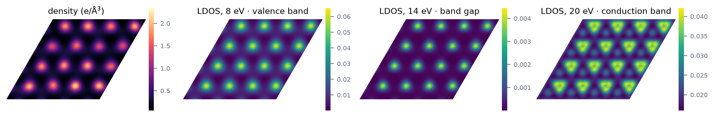

<p class="rs-kicker">Tutorial 6 · Observables</p>

# Real-space maps

<div class="rs-lead" markdown>
This tutorial computes the electron density and the local density of
states of a 128-atom diamond supercell on a 3D grid.
</div>

<div class="rs-chips">
  <span class="rs-chip rs-chip--intermediate">Intermediate</span>
  <span class="rs-chip">Model: lcao</span>
</div>

<div class="rs-learn" markdown>
**You will learn** to find the Fermi level, to compute the electron density
and local density of states on a grid, and to load the result.
</div>

## The input

<!-- rsatb-input: examples/tutorials/diamond_realspace.json -->

Three tasks, in order:

1. **`fermi_level`** finds the chemical potential that holds 256 electron
   pairs, two per carbon atom.
2. **`density`** maps the electron density on a grid with 0.25 Å spacing.
3. **`ldos`** maps the local density of states at seven energies.

!!! warning "The cell must be large enough"
    Real-space maps need every side of the cell to be longer than twice the
    cutoff radius of the orbitals, here $2 \times 3.70 = 7.41$ Å. That is why the
    cell is 4 × 4 × 4. A 3 × 3 × 3 diamond cell is 6.19 Å across, and the
    run stops with an error that states the required size.

## Run it

```bash
rsatb run examples/tutorials/diamond_realspace.json
```

```text
  fermi_level: n_electrons=256, mu=13.7787, ...
  density: n_point=68921, electrons_on_grid=510.189, ...
  ldos: n_point=68921, predicted_rel_error_max=0.0661694, ...
```

<figure markdown>

<figcaption>One plane through the crystal. <strong>Left:</strong> the
electron density, concentrated on the carbon atoms. <strong>Right:</strong>
the local density of states at three energies: in the valence band, in the band gap (an
order of magnitude weaker), and in the conduction band, which has a
different spatial distribution.</figcaption>
</figure>

## Checks

- **Electron count.** The density integrated over the grid gives 510.2 electrons,
  against the exact $2 \times 256 = 512$, a difference of 0.4% that is the noise of 32 random
  vectors.
- **The Fermi level is in the gap.** In an insulator, any chemical potential
  inside the gap holds the same number of electrons; `fermi_level` returns
  one such value, 13.78 eV, just above the top of the valence band.
- **The LDOS includes its estimated error,** at most 6.6% at these
  settings.

## Loading the maps

Each MPI process writes its own file, with its share of the grid points
and their indices:

```python
import glob
import numpy as np

run = "examples/tutorials/results/diamond_realspace"
parts = [np.load(p) for p in sorted(glob.glob(f"{run}/density.rank*.npz"))]

shape = tuple(parts[0]["shape"])                 # (41, 41, 41)
rho = np.zeros(int(np.prod(shape)))
for part in parts:
    rho[part["point_index"]] = part["density"]   # put each piece in place
rho = rho.reshape(shape)                         # electrons per ų
```

`rho[:, :, 0]` is the plane shown in the figure. The LDOS is assembled the
same way, with an extra energy axis; see
[Read and plot results](../guides/results.md#real-space-grids).

## Summary

- **Real-space tasks run at a single k-point** and need a cell larger than
  twice the orbital cutoff radius.
- **Each process writes its own piece** of the grid; reassemble with the
  snippet above.
- **Check `electrons_on_grid`.** It should be close to the electron count.

??? deep "Temperature and cost"
    The density is computed with a Fermi function at temperature `temp`; the
    polynomial degree, and so the cost, grows as $1/T$. For an insulator with
    a 4.5 eV gap, 3000 K and 1000 K give the same map, so the higher value is
    used here. In a metal the temperature changes the result and has to be
    chosen accordingly.

??? deep "Noise reduction"
    With `"fragment_buffer": 3.0` in the `density` task, a deterministic
    calculation on local fragments gives most of the map, and the random
    vectors correct the remainder. The run then reports `correction_rms`. Raising
    `n_samples` on `ldos` lowers `predicted_rel_error` as $1/\sqrt{n}$.
    Background: [Random-state traces](../theory/stochastic-trace.md#local-quantities).

## Next steps

[Tutorial 7](abacus-nextham.md) uses Hamiltonians from ABACUS and NextHam.
