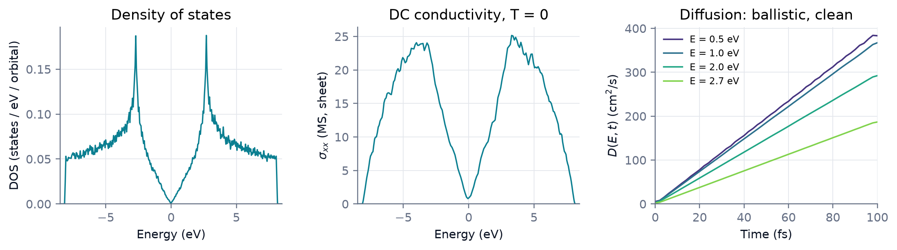

<p class="rs-kicker">Tutorial 4 · Observables</p>

# Transport

<div class="rs-lead" markdown>
The DC conductivity spectrum and the energy-resolved diffusion coefficient
of a graphene sheet (128 × 128 supercell, 32,768 atoms), computed from one
input.
</div>

<div class="rs-chips">
  <span class="rs-chip rs-chip--intermediate">Intermediate</span>
  <span class="rs-chip">≈ 2 min</span>
  <span class="rs-chip">Model: sktb</span>
</div>

<div class="rs-learn" markdown>
**You will learn** to run several observables in one go, to compute a
conductivity spectrum and a diffusion coefficient, and how to treat a 2D
material correctly.
</div>

## The input

<!-- rsatb-input: examples/tutorials/graphene_transport.json -->

What's new compared with Tutorial 1:

- **Three tasks in one input.** They share one setup.
- **`dc_spectrum`** gives the conductivity at every energy.
  `"axis": "ab"` tells RSATB that this is a sheet: it divides by the area of
  the sheet, not by a volume padded with vacuum.
- **`msd`** propagates wave packets for 100 fs and records their
  mean-square displacement along $x$.
- **`bounds` is fixed** at ±9 eV, which contains the spectrum; this skips the
  eigenvalue estimate during setup.

## Run it

```bash
rsatb run examples/tutorials/graphene_transport.json
```

<figure markdown>

<figcaption><strong>Left:</strong> the density of states.
<strong>Centre:</strong> the conductivity of the sheet at each energy — zero
at the Dirac point and at the band edges. <strong>Right:</strong> the
diffusion coefficient grows linearly in time at all energies, as expected
for ballistic transport in a crystal without disorder.</figcaption>
</figure>

## Comparison with the ballistic limit

Without scattering, the diffusion coefficient near the Dirac point is
$D(t) = \tfrac12 v_F^2\,t$, with the Fermi velocity

$$
v_F = \frac{3 \times 2.7\ \text{eV} \times 1.42\ \text{Å}}{2\hbar} = 8.74\ \text{Å/fs}
\quad\Rightarrow\quad D(100\ \text{fs}) = 382\ \text{cm}^2/\text{s}.
$$

The computed curves at 0.5 and 1 eV agree with this value.

## What to take away

- Several tasks in one input share the setup.
- For 2D materials, `"axis": "ab"` normalizes by the sheet area.
- The time dependence of $D(E,t)$ indicates the transport regime: linear
  (ballistic), constant (diffusive) or decreasing (localized).

??? deep "Under the hood: the magnitude of the DC conductivity"
    Without disorder the DC conductivity of a crystal diverges; the values in
    the plot are set by the energy resolution (256 moments). Physically meaningful DC values need scattering:
    disorder in the Hamiltonian, a cell large enough to hold it, and a
    resolution finer than the scattering rate. The diffusion curve reveals
    which regime you are in.

??? deep "Under the hood: reading the arrays"
    ```python
    import numpy as np

    run = "examples/tutorials/results/graphene_transport"
    XX = 0                                   # components: xx, xy, xz, yy, yz, zz

    dc = np.load(f"{run}/dc_spectrum.npz")
    energy, sigma_xx = dc["energy"], dc["sigma"][0, :, XX]   # siemens (sheet)

    msd = np.load(f"{run}/msd.npz")
    t, E = msd["time_fs"], msd["energy"]
    D = msd["diffusion"][0] * 0.1            # Ų/fs → cm²/s, shape (n_t, n_E)
    ```

    The theory behind both tasks is in
    [Linear response](../theory/linear-response.md).

## Try next

- Measure along $y$ with `"axis": "y"` in the `msd` task — graphene is
  isotropic, so the curves should match.
- Continue to [Tutorial 5](optics.md): optical spectra.
